# 🚗 TFM Proyecto 1 · Estimador de precio de coches de segunda mano

Modelo predictivo (regresión) que estima el **precio de venta de un coche de segunda mano en España** a partir de los datos de su anuncio (marca, modelo, año, kilómetros, potencia, combustible, cambio, provincia...).

> **Uso previsto:** una **guía de tasación** para una empresa de compraventa de coches usados.

---

## 📑 Tabla de contenidos

1. [Objetivo de negocio](#-objetivo-de-negocio)
2. [Dataset](#-dataset)
3. [Hipótesis previas](#-hipótesis-previas)
4. [Preguntas a responder](#-preguntas-a-responder)
5. [Modelos](#-modelos)
6. [Métricas y KPIs](#-métricas-y-kpis)
7. [Estructura del repositorio](#️-estructura-del-repositorio)
8. [Esquema del flujo](#-esquema-del-flujo)
9. [Preprocesado](#️-preprocesado)
10. [Flujo de ramas](#-flujo-de-ramas)
11. [Cómo ejecutar](#️-cómo-ejecutar)
12. [Visualizaciones](#️-visualizaciones)
13. [Resultados](#-resultados)
14. [Explicabilidad](#-explicabilidad)
15. [Dificultades](#️-dificultades)
16. [Paso a producción](#-paso-a-producción)
17. [Conclusiones y mejoras](#-conclusiones-y-mejoras)
18. [Uso de la IA](#-uso-de-la-ia)

---

## 🎯 Objetivo de negocio

Una empresa de compraventa de coches usados quiere estimar **a qué precio podrá vender un coche**. Con ese precio y el margen que busca, calcula **cuánto ofrecer al cliente** que viene a venderlo:

```
oferta = precio_estimado × (1 − margen) − costes_de_preparación
```

**¿Qué hace el modelo?** Una regresión que predice `price` a partir de la marca, el modelo, el año, los km, la potencia, el combustible, el cambio y la provincia.

---

## 📊 Dataset

| Característica | Detalle |
|---|---|
| Origen | Muestra gratuita de **DataMarket**: anuncios de una plataforma española de coches de segunda mano (web de origen anonimizada) |
| Tamaño | **50.000** anuncios · **21** columnas |
| Fechas de publicación | Del 09-05-2017 al 15-01-2021 |
| Fecha de captura | 15-01-2021 |
| Variable objetivo | `price` (€) |
| Descarga (CSV) | https://raw.githubusercontent.com/Data-Market/vehiculos-de-segunda-mano/main/coches-de-segunda-mano-sample.csv |
| Repositorio y documentación | https://github.com/Data-Market/vehiculos-de-segunda-mano |
| Dataset completo (de pago) | https://datamarket.es/#coches-de-segunda-mano-dataset |
| Licencia | Muestra de evaluación y uso gratuito (el repositorio no incluye licencia formal) |

⚠️ **Limitación:** son **precios de anuncio**, no precios de venta real.

📁 El CSV (`data/raw/coches_segunda_mano.csv`) **no se sube al repositorio** (`data/raw/` está en `.gitignore`).

---

## 💡 Hipótesis previas

*Las validaremos o refutaremos con los datos.*

- **H1:** los coches de alta gama se deprecian más rápido.
- **H2:** hay marcas que se deprecian menos que la media y otras que se deprecian más.
- **H3:** a igualdad de año, el precio va de mayor a menor así: eléctrico > diésel > gasolina.

**Estado tras el EDA** (primera validación en 02b_preguntas_eda.ipynb; el EDA, preguntas 1-7, está terminado):

| Hipótesis | Resultado | Dónde |
|---|---|---|
| H1 | **Refutada:** Audi, BMW y Mercedes conservan su valor por encima de la media | Pregunta 4 |
| H2 | **Apoyada:** unas marcas conservan su valor por encima de la media y otras por debajo | Pregunta 4 |
| H3 | **Apoyada** con los coches de 2018-2020: eléctrico 28.500 € > diésel 23.890 € > gasolina 17.900 € | Pregunta 5 |

**Estado tras el modelo** (simulación con el Random Forest en 06_explicabilidad_negocio.ipynb, cambiando solo la antigüedad o el combustible de los coches de test):

| Hipótesis | Resultado |
|---|---|
| H1 | **Refutada:** de 2 a 8 años la alta gama retiene el 71,2 % de su valor y el resto el 70,8 %; Mercedes-Benz es la que más retiene (74 %) |
| H2 | **Apoyada:** el valor retenido va del 64 % de Peugeot al 74 % de Mercedes-Benz |
| H3 | **Apoyada en parte:** el modelo da diésel 17.288 € > eléctrico 16.646 € > gasolina 16.265 €; el combustible apenas pesa porque su efecto lo recoge la variable model y hay pocos eléctricos |

---

## ❓ Preguntas a responder

### 🔍 Análisis exploratorio (EDA)
1. ¿Cómo se distribuye el precio y qué valores atípicos hay?
2. ¿Cuánto se deprecia un coche por cada año de antigüedad?
3. ¿Cuánto baja el precio por cada 10.000 km?
4. ¿Qué marcas conservan mejor su valor frente a otras?
5. ¿Cómo influyen el combustible y el tipo de cambio?
6. ¿Influye la provincia?
7. ¿Hay diferencias entre vendedor profesional y particular?

### 🤖 Modelo
8. ¿Qué variables influyen más en el precio? (explicabilidad)
9. ¿Qué modelo tasa mejor?
10. ¿Cuál es el error medio en € y en %?

### 💼 Negocio
11. Con un margen fijo (p. ej., 15 %), ¿en qué % de coches no perderíamos dinero?
12. ¿En qué coches falla más el modelo y hace falta revisión humana?
13. ¿Qué margen mínimo hace la oferta segura en el 90 % de los casos sin espantar al cliente?

---

## 🧠 Modelos

| Modelo | Papel |
|---|---|
| Regresión lineal | Línea base |
| Random Forest | Modelo de árboles (ensemble) |
| XGBoost | Gradient boosting |

**Resultados en test** (04_modelado.ipynb, 8.123 coches):

| Modelo | MAE (€) | MAPE (%) | RMSE (€) | R2 (log) | % coches con error < 15 % |
|---|---|---|---|---|---|
| Regresión lineal | 2.664 | 16,8 | 5.302 | 0,907 | 58,7 |
| Random Forest (ajustado) | 1.816 | 12,6 | 3.372 | 0,940 | 72,7 |
| XGBoost (ajustado) | 1.854 | 12,7 | 3.248 | 0,942 | 71,5 |

- **Ajuste de hiperparámetros:** RandomizedSearchCV con n_iter 10, cv 3 y el MAE como medida, solo sobre train.
- **Train frente a test:** el Random Forest sobreajusta más (MAE 670 € en train frente a 1.816 € en test); el XGBoost, menos (1.499 € frente a 1.854 €). La regresión lineal no sobreajusta (2.620 € frente a 2.664 €).
- El Random Forest tiene el menor MAE, MAPE y el mayor % de coches con error < 15 %; el XGBoost, el menor RMSE y el mayor R2.
- **Persistencia:** cada modelo entrenado se guarda con joblib en models/ y se carga en los cuadernos siguientes sin reentrenar. Es también la base para usarlo fuera del proyecto. joblib no se vio en el máster; es una aportación propia del TFM.

---

## 📏 Métricas y KPIs

### Técnicas
| Métrica | Qué mide | Por qué la usamos |
|---|---|---|
| **MAE** | Error medio en € | Habla el lenguaje del negocio: «me equivoco de media en X €» |
| **MAPE** | Error medio en % | Permite comparar coches baratos y caros |
| **RMSE** | Error en €, penaliza los errores grandes | Detecta tasaciones muy desviadas |

### De negocio
- **% de coches con error < 15 %** (el margen) → en cuántos no perderíamos dinero.
- **Dinero arriesgado de media por coche.**

### ⚖️ El error no pesa igual en los dos sentidos
- **Sobrevalorar** → pagamos de más y **perdemos dinero**.
- **Infravalorar** → como mucho, **el cliente se va**.

👉 Así que nos interesa un **modelo prudente**.

---

## 🗂️ Estructura del repositorio

```
tfm-p1-precio-coches/
├── data/
│   ├── raw/          # Datos originales, sin tocar (no se suben)
│   └── processed/    # Datos limpios listos para modelar (no se suben)
├── notebooks/        # Un cuaderno por fase (ver hoja de ruta)
├── models/           # Modelos entrenados (no se suben)
├── outputs/          # Gráficos, tablas e informes generados
├── docs/             # Presentación de negocio en PDF
├── requirements.txt  # Dependencias
├── DECISIONES.md     # Registro diario de decisiones
└── README.md
```

### 📓 Hoja de ruta de cuadernos

Cada cuaderno hace **solo su fase**: lee lo que deja el anterior y guarda lo que necesita el siguiente.

| # | Cuaderno | Qué hace | Lee | Guarda |
|---|---|---|---|---|
| 1 | `01_eda.ipynb` | Explora y anota decisiones (no modifica datos) | `data/raw/` | — |
| 2 | `02_limpieza.ipynb` | Aplica las decisiones del EDA (columnas, nulos, potencia) | `data/raw/` | `data/processed/coches_limpio.csv` |
| 2b | `02b_preguntas_eda.ipynb` | Preguntas 1-7 y primera validación de H1-H3 (no modifica datos) | `coches_limpio.csv` | figuras en `outputs/figures/` |
| 3 | `03_preprocesado.ipynb` | Encoding, train/test, escalado (solo para la lineal) | `coches_limpio.csv` | train/test en `data/processed/` |
| 4 | `04_modelado.ipynb` | Entrena regresión lineal, Random Forest y XGBoost | train/test | `models/` |
| 5 | `05_evaluacion.ipynb` | Compara los modelos, analiza la sobrevaloración y dónde fallan, y elige el modelo | `models/` + test | `outputs/` |
| 6 | `06_explicabilidad_negocio.ipynb` | SHAP, hipótesis, preguntas 11-13, paso a producción | mejor modelo + test | `outputs/` |

> No usamos PCA: hay pocas variables y queremos un modelo explicable. El escalado solo se aplica a la regresión lineal.

---

## 🔀 Esquema del flujo

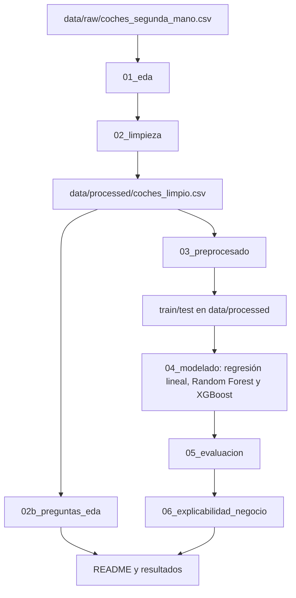

---

## ⚙️ Preprocesado

Decisiones aplicadas en 03_preprocesado.ipynb:

- **Variable objetivo:** log(price).
- **Antigüedad:** age = 2021 − year (los datos se capturaron en enero de 2021).
- **Columnas eliminadas:** publish_date y photos.
- **Binarias 0/1:** is_professional y shift (automático = 1).
- **Provincia:** se sustituye por isla 0/1 (Las Palmas, Tenerife y Baleares = 1).
- **Combustible:** one-hot antes de separar (no aprende nada de los datos).
- **Train/test:** 80/20 con random_state 42.
- **Marca:** las 10 más frecuentes en train y el resto en Other, con one-hot ajustado en train.
- **Modelo:** TargetEncoder ajustado solo en train.
- **Escalado:** StandardScaler solo para la regresión lineal.

---

## 🌿 Flujo de ramas

- **`develop`** → rama de trabajo del día a día.
- **`main`** → solo lo terminado y revisado.
- **`experiment/...`** → pruebas (p. ej., `experiment/xgboost`), que se fusionan en `develop` si salen bien.

---

## ▶️ Cómo ejecutar

El proyecto se ha desarrollado con Python 3.14.

1. Clonar el repositorio y entrar en la carpeta:

```bash
git clone https://github.com/rusamen86/tfm-p1-precio-coches.git
cd tfm-p1-precio-coches
```

2. Crear el entorno virtual e instalar las dependencias:

```bash
python -m venv .venv
source .venv/bin/activate
pip install -r requirements.txt
```

3. Los datos ya están en el repositorio, en `data/raw/coches_segunda_mano.csv`. La fuente original está enlazada en la sección [Dataset](#-dataset).

4. Abrir Jupyter (`jupyter notebook`) y ejecutar los cuadernos de `notebooks/` en este orden, cada uno de principio a fin:

   1. `01_eda.ipynb`
   2. `02_limpieza.ipynb`
   3. `02b_preguntas_eda.ipynb`
   4. `03_preprocesado.ipynb`
   5. `04_modelado.ipynb`
   6. `05_evaluacion.ipynb`
   7. `06_explicabilidad_negocio.ipynb`

Cada cuaderno lee lo que guarda el anterior. 04_modelado guarda los modelos entrenados en `models/`, y 05 y 06 los cargan de ahí sin volver a entrenar. En 06, el cálculo de SHAP tarda un par de minutos.

---

## 🖼️ Visualizaciones

### 🔍 EDA

Figuras generadas en notebooks/01_eda.ipynb y notebooks/02b_preguntas_eda.ipynb (se guardan con plt.savefig en outputs/figures/).

**Distribución de las variables numéricas:** histogramas de precio, kilómetros, potencia y fotos; todas con cola a la derecha.

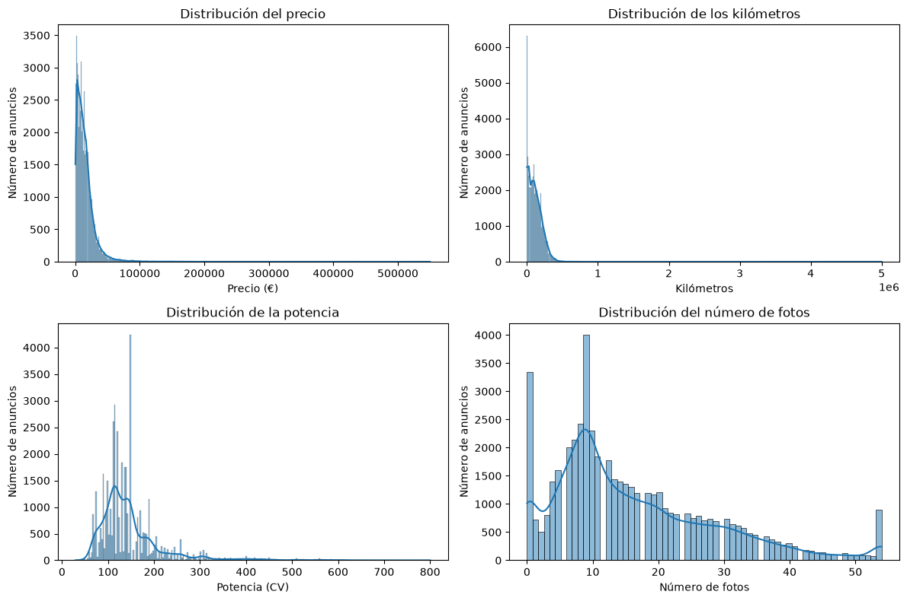

**Diagramas de caja:** valores que se alejan del resto en precio, kilómetros, potencia y fotos.

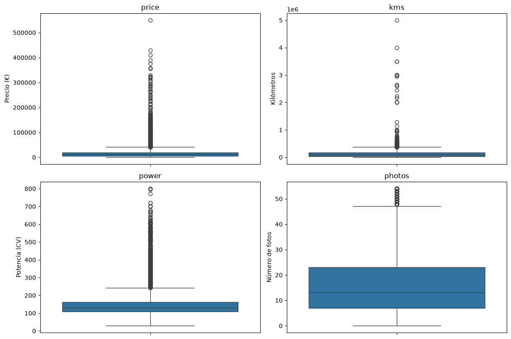

**Logaritmo del precio:** en escala logarítmica el precio se parece mucho más a una campana.

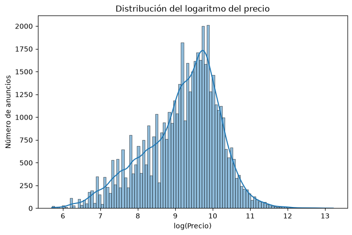

**Mediana del precio por año:** el precio baja de forma regular con la antigüedad (≈ 11-12 % por año).

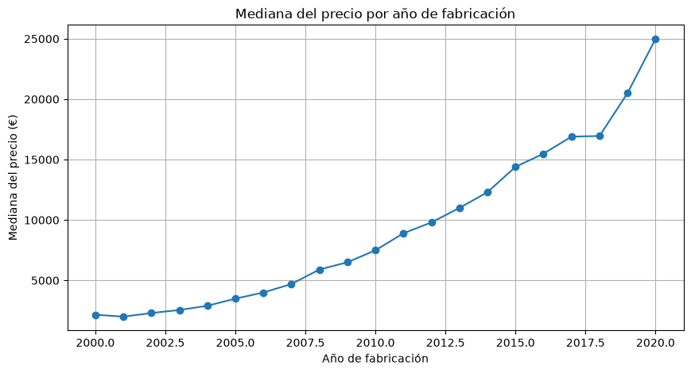

**Mediana del precio por tramo de kilómetros (Pregunta 3):** el precio baja de forma regular con los kilómetros (≈ 657 € cada 10.000 km).

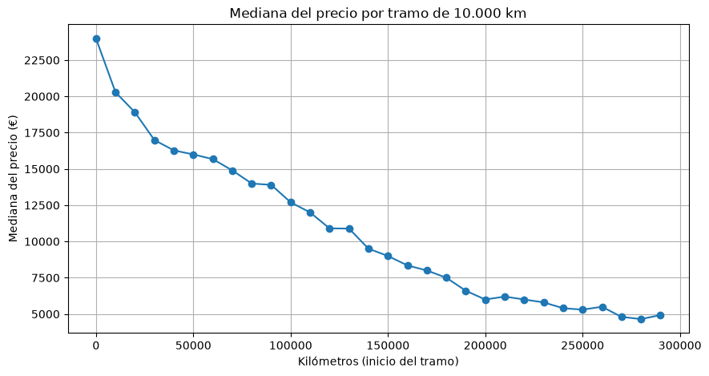

**Valor retenido por marca (Pregunta 4):** mediana de los coches de 2013-2015 frente a la de 2018-2020; Fiat, Audi y Volkswagen son las que mejor conservan su valor.

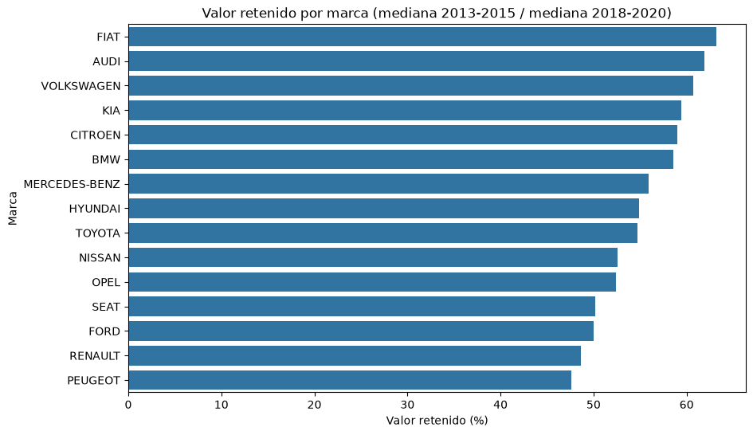

**Mediana del precio por combustible (Pregunta 5):** con los coches de 2018-2020, eléctrico (28.500 €) > diésel (23.890 €) > gasolina (17.900 €).

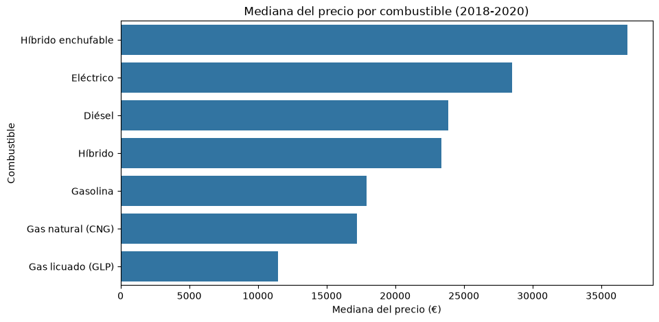

**Mediana del precio por tipo de cambio (Pregunta 5):** con los coches de 2018-2020, un automático vale de mediana 30.800 € frente a 17.400 € de un manual.

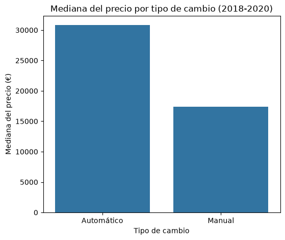

**Mediana del precio por provincia (Pregunta 6):** en la península hay poca diferencia entre provincias; Canarias y Baleares salen más baratas.

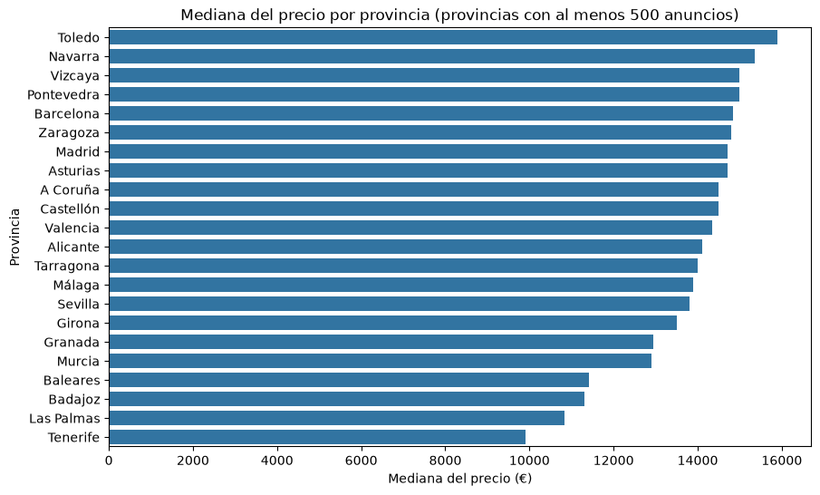

**Mediana del precio por tipo de vendedor (Pregunta 7):** con todos los años, un profesional anuncia a 15.999 € y un particular a 7.800 €; con los coches de 2018-2020 la diferencia desaparece (20.900 € frente a 21.000 €).

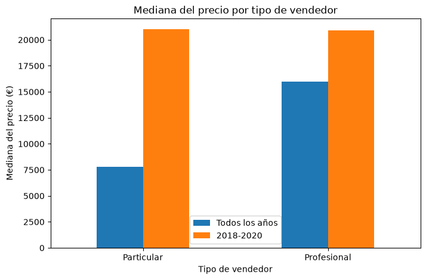

### 🤖 Modelos

Figuras generadas en notebooks/04_modelado.ipynb con los coches de test.

**Real frente a predicho, regresión lineal:** MAE de 2.664 € y solo el 58,7 % de los coches con error < 15 %.

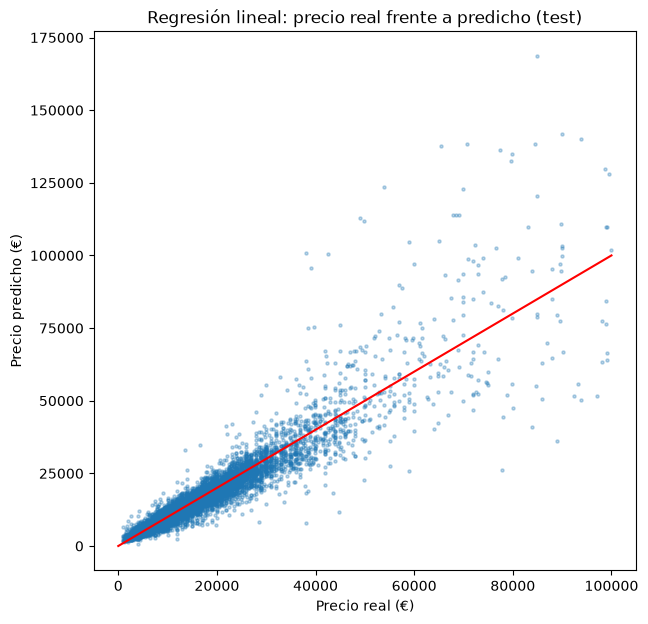

**Importancia de las variables, Random Forest:** age (0,34), model (0,27), power (0,16) y kms (0,13) son las que más pesan.

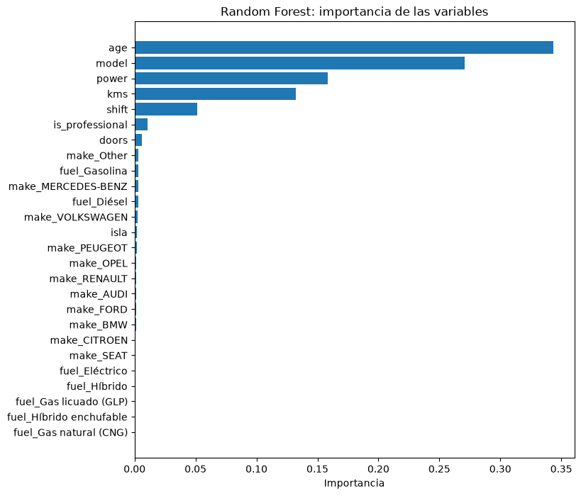

**Real frente a predicho, Random Forest (ajustado):** MAE de 1.816 € y el 72,7 % de los coches con error < 15 %.

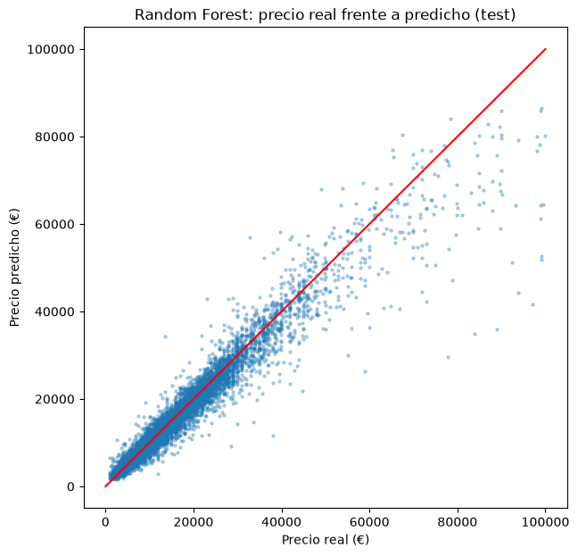

**Importancia de las variables, XGBoost:** age (0,39) es la más importante, seguida de model (0,13), power (0,13) y shift (0,07).

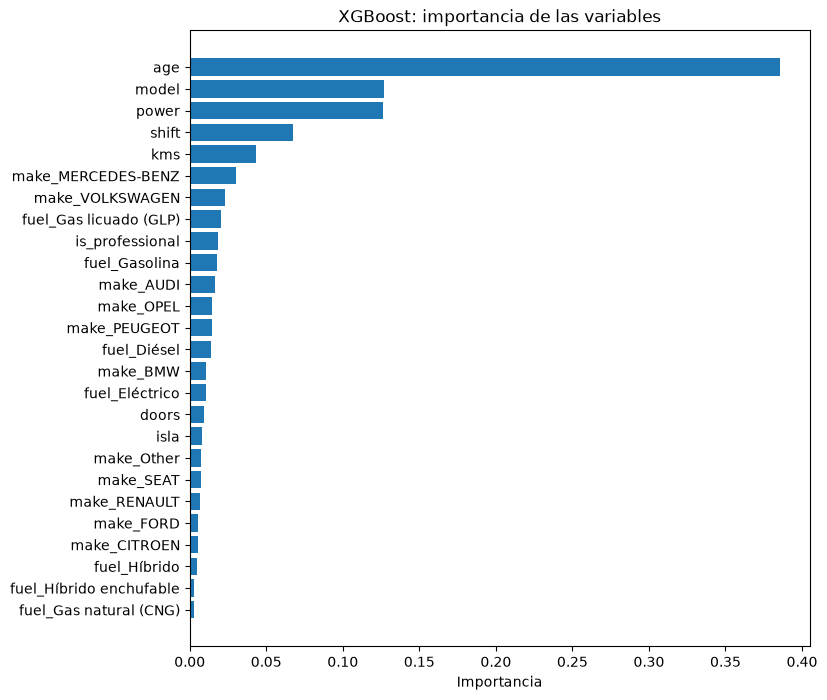

**Real frente a predicho, XGBoost (ajustado):** MAE de 1.854 € y el 71,5 % de los coches con error < 15 %.

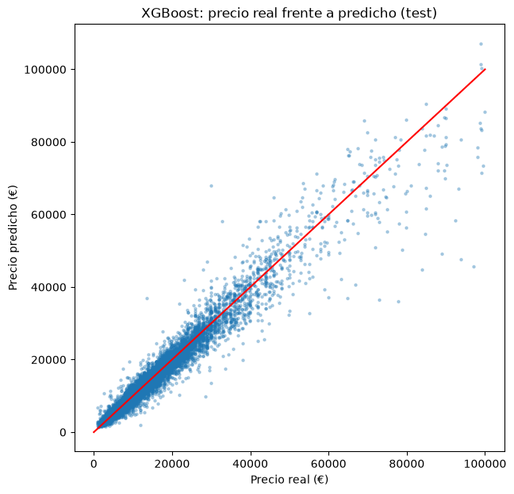

---

### 📏 Evaluación

Figuras generadas en notebooks/05_evaluacion.ipynb con los coches de test.

**Error porcentual medio por rango de precio:** los dos modelos fallan mucho más en los coches de menos de 5.000 € (28-29 %) y menos entre 10.000 y 40.000 € (9-10 %).

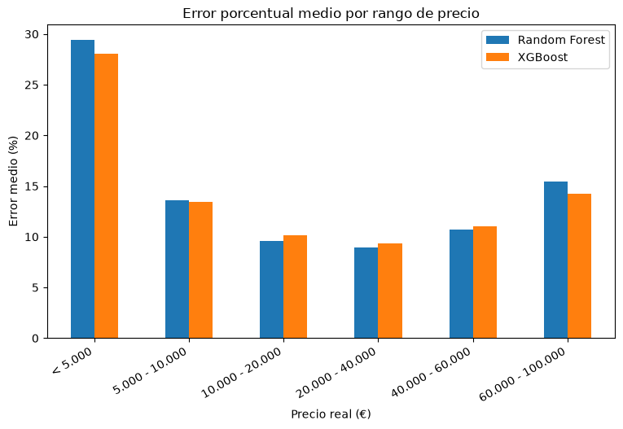

**Error porcentual medio por antigüedad:** el error crece con los años, del 8-9 % en coches de hasta 3 años a más del 22 % en los de más de 12.

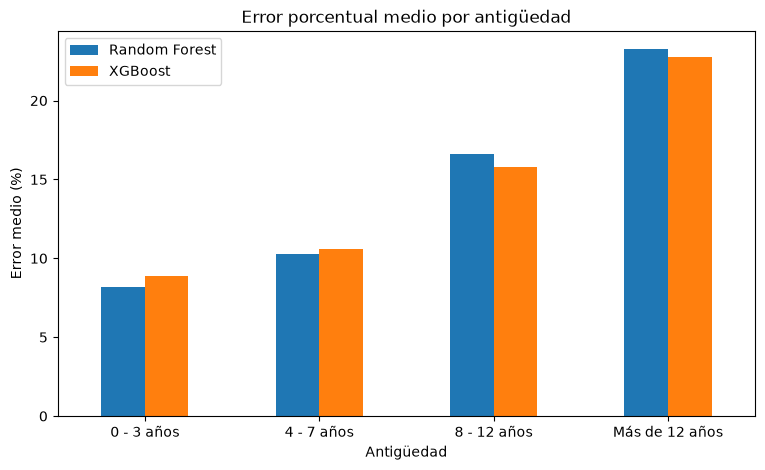

---

## 📈 Resultados

**Modelo elegido: Random Forest** (05_evaluacion.ipynb).

La regresión lineal se descarta por sus peores métricas. Random Forest y XGBoost están muy igualados, así que la elección se hace con criterios de negocio:

| Modelo | Coches sobrevalorados | Sobrevaloración media | Sobrevaloración total en test |
|---|---|---|---|
| Random Forest | 49,9 % | 1.537 € | 6,23 M€ |
| XGBoost | 50,1 % | 1.624 € | 6,61 M€ |

- Random Forest pone menos dinero en riesgo, unos 380.000 € menos en los 8.123 coches de test.
- Acierta más en los coches de 10.000 a 40.000 € y en los de hasta 3 años, el grueso de las compras.
- Los dos modelos fallan más en coches baratos (menos de 5.000 €) y antiguos (más de 12 años), cuyo precio depende del estado del coche, que no está en los datos.
- XGBoost queda como alternativa: resultados muy cercanos y más estable entre train y test.
- No se reentrena para que el modelo infravalore: la protección frente al error la da el margen de la oferta (preguntas 11 y 13).

## 🔎 Explicabilidad

SHAP sobre el Random Forest con una muestra de 500 coches de test (06_explicabilidad_negocio.ipynb). Como el modelo predice el logaritmo del precio, un valor SHAP de 0,10 equivale a un 10 % más de precio, aproximadamente.

- **age** es la variable que más pesa: los coches viejos bajan el precio y los nuevos lo suben.
- **model** y **power** suben el precio cuando son altos; **kms** lo baja cuando son muchos.
- El cambio automático (**shift**) suma alrededor de un 10 %.
- Vendedor, combustible, puertas y marca pesan muy poco.

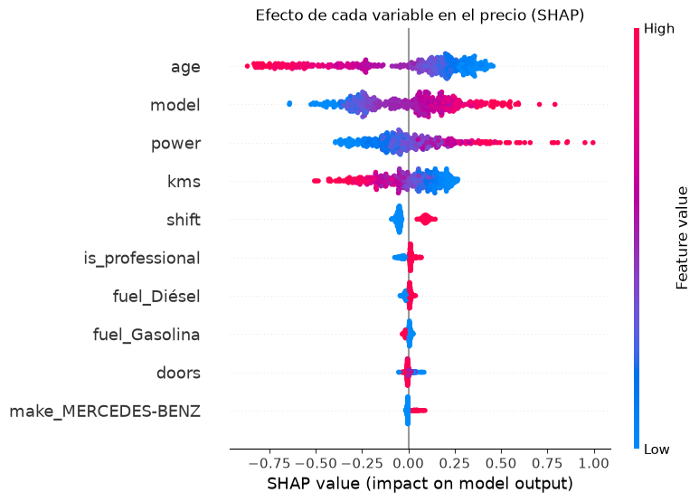

### 💼 Preguntas de negocio

La oferta no da pérdidas si queda por debajo del precio real del coche. No se incluyen costes de preparación por falta de datos.

| Margen | Coches sin pérdida |
|---|---|
| 5 % | 67,4 % |
| 10 % | 80,1 % |
| 15 % | 88,3 % |
| 20 % | 93,0 % |
| 25 % | 95,6 % |

- **Pregunta 11:** con un margen del 15 %, no se pierde dinero en el 88,3 % de los coches.
- **Pregunta 13:** el margen mínimo seguro en el 90 % de los casos es del 16,5 %. Con él, la oferta mediana es el 83,4 % del precio real del coche.
- **Pregunta 12** (05_evaluacion.ipynb): los coches de menos de 5.000 € y los de más de 12 años son los que conviene revisar a mano.

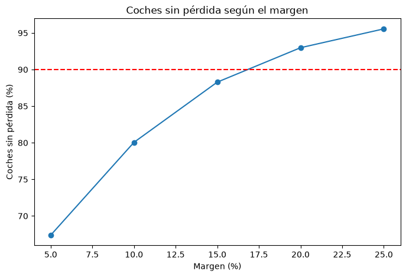

## 🛠️ Dificultades

### 1. Limpieza de la potencia

- **Problema:** power tenía 8.528 nulos (17 %), sobre todo en coches viejos y baratos, y es una de las variables que más pesan en el precio. Tras los cortes (precio de 1.000 € a 100.000 €, hasta 1.000.000 km, hasta 700 CV y coches de 2006 en adelante) quedaban 3.842 nulos (9,4 %).
- **Qué se probó:** buscar coches gemelos con la misma marca, modelo y versión. Solo 53 lo tenían, porque la versión casi nunca describe el motor.
- **Qué se decidió:** 17 coches toman la potencia del texto de version (los kW se pasan a CV). El resto se rellena con la moda de su marca + modelo, y se eliminan los 60 que no tienen ningún coche de la misma marca y modelo con potencia. No se usó la media ni la mediana porque pueden dar potencias que no existen en ese modelo; la moda es un motor real y frecuente.
- **Columnas eliminadas:** price_financed (vacía en más de la mitad y casi igual que price), url, company y country (no describen el coche), dealer (casi 10.000 valores distintos), color (miles de formas de escribirse), insert_date (el mismo valor en todos) y version, después de usarla para la potencia.
- **Lección:** antes de rellenar un dato hay que medir qué información real hay detrás, y es mejor quitar unos pocos coches que inventar valores.

### 2. Codificación de las columnas no numéricas

- **Problema:** los modelos necesitan números, y había columnas de texto con muchas categorías: 52 provincias, muchas marcas y 690 modelos distintos en train.
- **Qué se decidió:**
  - shift e is_professional pasan a 0/1 (automático = 1, profesional = 1).
  - La provincia se sustituye por una sola columna, isla (Las Palmas, Tenerife y Baleares = 1), porque en la península apenas cambia el precio y en las islas los coches son más baratos.
  - Combustible con one-hot.
  - Marca: las 10 más frecuentes y el resto en Other, con one-hot.
  - Modelo con target encoding: cada modelo se sustituye por la media del logaritmo del precio en train. Con 690 modelos, una columna por cada uno no era viable.
- **Lección:** todo lo que aprende de los datos (marca, target encoding y escalado) se ajusta solo con train y después se aplica a test, para que el test no influya en el preprocesado.

### 3. Elección final del modelo

- **Problema:** Random Forest y XGBoost quedaron casi empatados. Random Forest gana en MAE (1.816 € frente a 1.854 €) y en MAPE (12,6 % frente a 12,7 %), y XGBoost en RMSE (3.248 € frente a 3.372 €).
- **Qué se decidió:** elegir con un criterio de negocio: cuántos euros sobrevalora cada modelo, porque sobrevalorar hace perder dinero. Random Forest suma 6,23 millones de euros sobrevalorados en test y XGBoost 6,61 millones. Random Forest también acierta más entre 10.000 y 40.000 € y en los coches de hasta 3 años, que son el grueso del negocio.
- **XGBoost queda como alternativa**, porque es más estable entre train y test.
- **No se reentrenó** ningún modelo para que infravalore: la protección frente al error la da el margen de la oferta.
- **Lección:** cuando las métricas generales empatan, hay que mirar el error desde el punto de vista del negocio.

---

## 🚀 Paso a producción

Para llevar el estimador a un uso real, el código de los cuadernos se pasaría a scripts y el modelo final se guardaría ya entrenado. Ese modelo se serviría mediante una API dentro de un contenedor Docker, y se reentrenaría periódicamente con anuncios nuevos.

## ✅ Conclusiones y mejoras

### Conclusiones

- **El modelo es útil para el negocio con un margen adecuado.** El Random Forest se equivoca de media en 1.816 € (un 12,6 % del precio). Con un margen del 15 % no se pierde dinero en el 88,3 % de los coches, y con un 16,5 % en el 90 %, ofreciendo al vendedor típico un 83 % del valor de su coche.
- **La elección del modelo se hizo con criterios de negocio.** Random Forest y XGBoost empatan en las métricas técnicas. Se eligió el Random Forest porque pone menos dinero en riesgo (unos 380.000 € menos de sobrevaloración en test) y acierta más en los coches de 10.000 a 40.000 € y de hasta 3 años, el grueso de las compras.
- **El precio lo explican sobre todo la antigüedad, el modelo, la potencia y los kilómetros.** El cambio automático suma alrededor de un 10 %; el resto de variables apenas pesa.
- **La marca importa, pero no como se esperaba.** La alta gama no se deprecia más rápido (H1 refutada): Mercedes-Benz es la que más valor retiene. Entre marcas hay hasta 10 puntos de diferencia en valor retenido (H2 apoyada).
- **El combustible pesa poco una vez conocido el modelo del coche** (H3 apoyada solo en parte).
- **El modelo no sustituye a la persona en todos los casos.** Los coches de menos de 5.000 € y los de más de 12 años tienen errores del 22-29 %. Para ellos conviene una revisión manual antes de hacer la oferta.

### Mejoras para una versión futura

- **Datos más recientes.** El dataset termina en enero de 2021; los precios de segunda mano han cambiado mucho desde entonces.
- **Variables sobre el estado del coche** (revisiones, golpes, ITV, equipamiento), que explicarían buena parte del error en los coches baratos y antiguos.
- **Costes de preparación reales** para calcular la oferta completa y el beneficio por coche.
- **Margen variable por tramo:** un margen menor en los coches donde el modelo acierta más y uno mayor (o revisión manual) en los baratos y antiguos.
- **Más datos de coches eléctricos e híbridos,** que hoy son pocos y el modelo apenas aprende de ellos.

---

## 💬 Uso de la IA

En este proyecto he usado un asistente de IA como apoyo para escribir código, resolver errores y mantener la documentación (README y DECISIONES.md). Las decisiones del proyecto y la revisión de cada resultado son mías. Cuando aparecía algo nuevo para mí (por ejemplo joblib, que no se vio en el máster, o pd.cut), lo pedía explicado y no lo daba por bueno hasta entenderlo; esas explicaciones están en los propios cuadernos.
