# TFM Proyecto 1 · Un tasador de coches de segunda mano

Un modelo que estima a qué precio se puede vender un coche de segunda mano en España a partir de los datos de su anuncio: marca, modelo, antigüedad, kilómetros, potencia, combustible y cambio. Con ese precio y el margen que busca la empresa, calcula cuánto ofrecer a quien viene a vender su coche. Se puede seguir en los cuadernos o probar en una página web: [tasador-coches-ocasion.streamlit.app](https://tasador-coches-ocasion.streamlit.app/).

## Por qué este proyecto

Me dedico al sector de la automoción: trabajo en un taller. Desde que empecé el máster, mi idea era aplicar el TFM a lo que hago cada día, que es la gestión de recambios. La marca tiene un sistema automático de reaprovisionamiento que decide qué piezas pedir según su coste y sus ventas, y yo quería evaluarlo: comprobar si funciona tan bien como parece o si, como sospecho, tira más a beneficio de la marca que del taller.

Al ir a sacar los datos me topé con la realidad. Están cautivos en el sistema de gestión de la marca y no puedo trabajar con ellos como necesitaba para un proyecto así.

Descartado eso, encontré un conjunto de anuncios de coches de segunda mano. Sigue siendo el mundo que conozco, me daba curiosidad poder hacerle preguntas y los datos eran apropiados, así que me quedé con él.

## El encargo

Lo he planteado como un encargo dentro de una empresa. La empresa es un concesionario Seat inventado para el proyecto, con su sección de vehículos de ocasión. Esa sección compra coches a particulares para revenderlos, y pide una guía de tasación: una estimación del precio al que podrá vender cada coche, para decidir cuánto ofrecer por él.

```
oferta = precio estimado × (1 − margen) − costes de preparación
```

En este negocio equivocarse no pesa igual en los dos sentidos. Si la tasación se pasa, el concesionario paga de más y pierde dinero. Si se queda corta, como mucho el cliente se va con su coche. Por eso me interesaba un modelo prudente, y por eso además del error medio he mirado cuánto dinero pone en riesgo cada modelo.

Antes de abrir los datos escribí tres hipótesis, para no ajustarlas después a lo que viera:

- H1: los coches de alta gama se deprecian más rápido.
- H2: hay marcas que se deprecian menos que la media y otras que se deprecian más. La idea viene de un rumor del sector, que los Volkswagen pierden menos valor que el resto. Empecé escribiéndola solo para Volkswagen y después la dejé en la forma general, que es la pregunta que de verdad le interesa al trabajo.
- H3: a igualdad de año, un eléctrico vale más que un diésel y un diésel más que un gasolina.

Y trece preguntas, que son las que van respondiendo los cuadernos:

1. ¿Cómo se distribuye el precio y qué valores atípicos hay?
2. ¿Cuánto se deprecia un coche por cada año de antigüedad?
3. ¿Cuánto baja el precio por cada 10.000 km?
4. ¿Qué marcas conservan mejor su valor?
5. ¿Cómo influyen el combustible y el tipo de cambio?
6. ¿Influye la provincia?
7. ¿Hay diferencias entre vendedor profesional y particular?
8. ¿Qué variables influyen más en el precio?
9. ¿Qué modelo tasa mejor?
10. ¿Cuál es el error medio en euros y en porcentaje?
11. Con un margen fijo del 15 %, ¿en qué porcentaje de coches no perderíamos dinero?
12. ¿En qué coches falla más el modelo y hace falta que los revise una persona?
13. ¿Qué margen mínimo hace la oferta segura en el 90 % de los casos sin espantar al cliente?

## Los datos

| | |
|---|---|
| Origen | Muestra gratuita de DataMarket: anuncios de una plataforma española de coches de segunda mano (la web de origen está anonimizada) |
| Tamaño | 50.000 anuncios y 21 columnas |
| Fechas de publicación | Del 09-05-2017 al 15-01-2021 |
| Fecha de captura | 15-01-2021 |
| Variable objetivo | price, en euros |
| Descarga (CSV) | https://raw.githubusercontent.com/Data-Market/vehiculos-de-segunda-mano/main/coches-de-segunda-mano-sample.csv |
| Repositorio y documentación | https://github.com/Data-Market/vehiculos-de-segunda-mano |
| Dataset completo (de pago) | https://datamarket.es/#coches-de-segunda-mano-dataset |
| Licencia | Muestra de evaluación y uso gratuito (el repositorio no incluye licencia formal) |

Hay dos cosas que conviene tener presentes desde el principio. Son precios de anuncio, no de venta real: lo que pide el vendedor, no lo que se acaba pagando. Y son de enero de 2021, así que no sirven para tasar un coche hoy.

El CSV está en el repositorio, en data/raw/coches_segunda_mano.csv, y no se modifica en ningún momento.

## Lo que más me costó: limpiar los datos

Lo más difícil llegó nada más empezar. Había datos que seguramente eran importantes para el precio y que faltaban en muchos anuncios, y tuve que darle vueltas a cómo completarlos de la forma más cercana posible a la realidad. Aquí la IA me ayudó bastante a valorar opciones.

El caso más claro fue la potencia. Faltaba en 8.528 anuncios, el 17 %, y no al azar: los coches sin potencia eran mucho más viejos y baratos (mediana de 3.100 € y año 2005, frente a 13.995 € y 2016 en los que sí la tenían). Quitar la columna no era una opción, porque la potencia es de lo que más pesa en el precio.

Antes de rellenar nada, decidí a qué coches se iba a aplicar el modelo. Son cortes de negocio, no correcciones de errores: precio entre 1.000 € y 100.000 €, porque por debajo el concesionario no compra y por encima son casos aislados; hasta 1.000.000 km; hasta 700 CV; y coches de 2006 en adelante, es decir, de hasta 15 años. Con eso salen 9.199 anuncios, la mayoría por la antigüedad, y los que quedan sin potencia bajan a 3.842, el 9,4 %.

Para esos probé primero lo que parecía más fiable: buscar un coche gemelo, con la misma marca, modelo y versión, y copiarle la potencia. Solo 53 lo tenían. El texto de la versión casi nunca describe el motor; muchas veces es solo la marca. Lo que sí encontré fueron 17 anuncios con la potencia escrita en ese texto ("FIAT 500 1.2 8v 51kW 69CV Lounge"), y esos tomaron su dato de ahí, pasando los kW a CV cuando hacía falta.

El resto lo rellené con la moda de su marca y modelo, la potencia más repetida entre los coches iguales. No usé la media ni la mediana porque pueden dar una potencia que no existe en ese modelo, mientras que la moda es un motor real y frecuente. Si dos potencias empatan, se queda la más baja, que es la opción prudente porque da un precio algo menor. Quedaron 60 coches sin ningún otro de su misma marca y modelo con potencia, y los eliminé. Preferí perder unos pocos coches a inventarme el dato.

El color también me costó decidirlo. Estaba escrito de miles de formas distintas y unificarlo era un trabajo desproporcionado para lo poco que influye en el precio de un coche usado, así que lo descarté. También salieron las columnas que no describen el coche (el identificador del anuncio, la empresa, el país, el vendedor y la fecha de carga) y el precio financiado, que faltaba en más de la mitad de los anuncios y va casi a la par que el precio (correlación de 0,997).

De los 50.000 anuncios quedan 40.614: 9.199 fuera por los cortes, 60 por no tener potencia ni gemelos y 127 por pequeños huecos en combustible, cambio o provincia. A partir de ahí, la preparación fue más sencilla.

## Lo que vi al explorar

El precio tiene una cola larga hacia los coches caros. Con el logaritmo la distribución se parece mucho más a una campana (la asimetría pasa de 2,1 a −0,4), y esa es la razón de que el modelo prediga el logaritmo del precio y no el precio.

Cada año de antigüedad resta alrededor de un 12 % del precio (12,1 % de media, 12,3 % de mediana). Al ser un porcentaje, el coche pierde más euros cuando es nuevo que cuando ya es viejo.

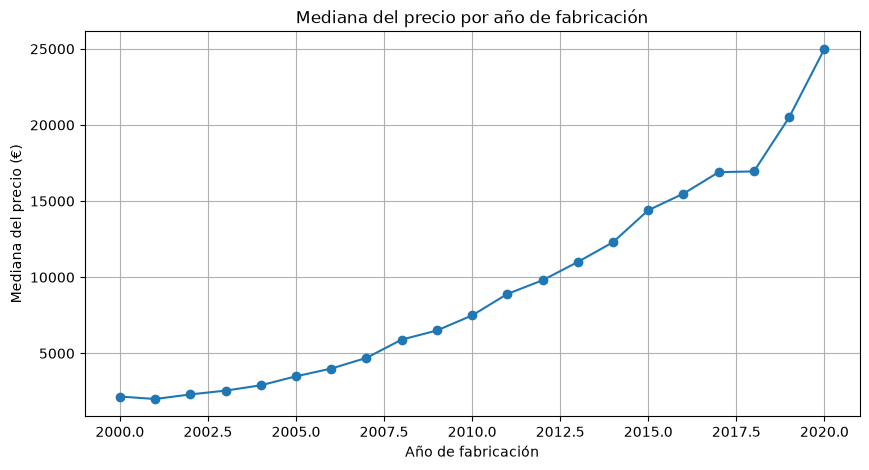

Con los kilómetros pasa algo parecido: cada 10.000 km restan unos 657 € de mediana. Pero kilómetros y año van muy unidos (correlación de −0,77), así que parte de esa bajada es en realidad la edad.

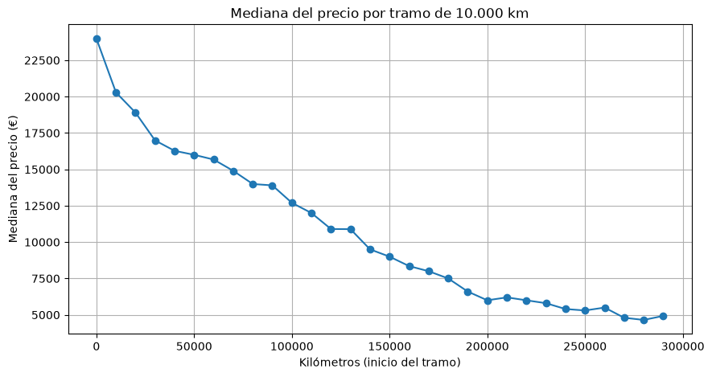

Lo que más me sorprendió fue la provincia. Yo pensaba que habría diferencias claras entre Madrid, Barcelona y las ciudades más pequeñas, y el precio es bastante más homogéneo en toda la península de lo que creía: de las 22 provincias con al menos 500 anuncios, 16 quedan entre 13.500 € y 15.900 € de mediana. La más cara me sale Toledo, pero hay que leerlo con cuidado, porque depende de qué coches se anuncian en cada sitio: muchos de los coches recientes de Toledo son prácticamente km 0. Lo único que se repite, mire como lo mire, es que en Canarias y Baleares los coches salen más baratos.

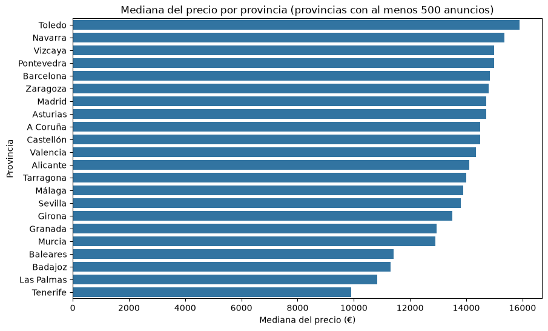

Con las marcas tampoco salió lo que esperaba. Comparando la mediana de los coches de 2013-2015 con la de los de 2018-2020, las que mejor conservan su valor son Fiat (63,2 %), Audi (61,9 %) y Volkswagen (60,7 %), y las que peor, Peugeot (47,6 %) y Renault (48,6 %). La media de las 15 marcas con más anuncios es del 55,3 %. Es una primera mirada, porque dentro de cada marca no comparo los mismos modelos: Fiat puede salir tan arriba porque abundan coches pequeños como el 500.

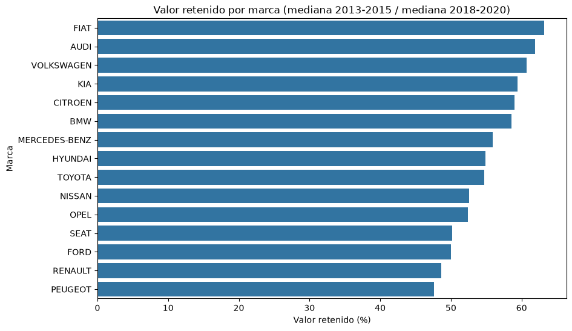

El resto lo cuento más rápido. En los coches de 2018 a 2020, un eléctrico se anuncia a 28.500 € de mediana, un diésel a 23.890 € y un gasolina a 17.900 €, y un automático a 30.800 € frente a los 17.400 € de un manual. Un profesional anuncia a más del doble que un particular (15.999 € frente a 7.800 €), pero porque vende coches más nuevos: en los de 2018 a 2020 la diferencia desaparece (20.900 € frente a 21.000 €).

Las demás figuras del análisis están en outputs/figures.

## Los modelos

Antes de entrenar hubo que convertir todo a números (cuaderno 03). Cambié el año por la antigüedad a enero de 2021, que es cuando se capturaron los datos. El cambio y el tipo de vendedor pasan a 0/1. La provincia, visto lo anterior, se queda en una sola columna que dice si el coche está en las islas. El combustible va con una columna por tipo. De la marca me quedo con las 10 más frecuentes y agrupo el resto. Con el modelo del coche no podía hacer lo mismo, porque hay 690 distintos, así que cada uno se sustituye por la media del logaritmo del precio de ese modelo (target encoding).

Separé 32.491 coches para entrenar y 8.123 para probar. Todo lo que se aprende de los datos (las marcas frecuentes, el target encoding y el escalado) se ajusta solo con los de entrenamiento, para que los de prueba no influyan en nada.

Probé tres modelos, de lo más simple a lo más potente (cuaderno 04): una regresión lineal como punto de partida, un Random Forest y un XGBoost. Los dos últimos, con un ajuste de hiperparámetros por búsqueda aleatoria (10 combinaciones, validación cruzada de 3).

| Modelo | MAE (€) | MAPE (%) | RMSE (€) | R2 (log) | Coches con error menor del 15 % |
|---|---|---|---|---|---|
| Regresión lineal | 2.664 | 16,8 | 5.302 | 0,907 | 58,7 % |
| Random Forest | 1.816 | 12,6 | 3.372 | 0,940 | 72,7 % |
| XGBoost | 1.854 | 12,7 | 3.248 | 0,942 | 71,5 % |

El ajuste mejoró poco: el Random Forest pasó de 1.849 € a 1.816 € de MAE y el XGBoost de 1.918 € a 1.854 €.

La regresión lineal queda descartada. Entre los otros dos hay un empate: el Random Forest gana en MAE y MAPE, y el XGBoost en RMSE, es decir, comete menos errores muy grandes. Como las métricas no decidían, volví al encargo y miré lo que le duele al concesionario, que es la sobrevaloración (cuaderno 05).

| Modelo | Coches sobrevalorados | Sobrevaloración media | Sobrevaloración total en test |
|---|---|---|---|
| Random Forest | 49,9 % | 1.537 € | 6,23 M€ |
| XGBoost | 50,1 % | 1.624 € | 6,61 M€ |

Elegí el Random Forest. Pone unos 380.000 € menos en riesgo en los 8.123 coches de prueba, y acierta algo más en los coches de 10.000 a 40.000 € y en los de hasta 3 años, que son el grueso de las compras. Tiene una pega que no quiero esconder: se ajusta mucho más a los datos con los que aprendió (670 € de MAE en entrenamiento frente a 1.816 € en prueba), mientras que el XGBoost es más estable (1.499 € frente a 1.854 €). Por eso el XGBoost queda como alternativa.

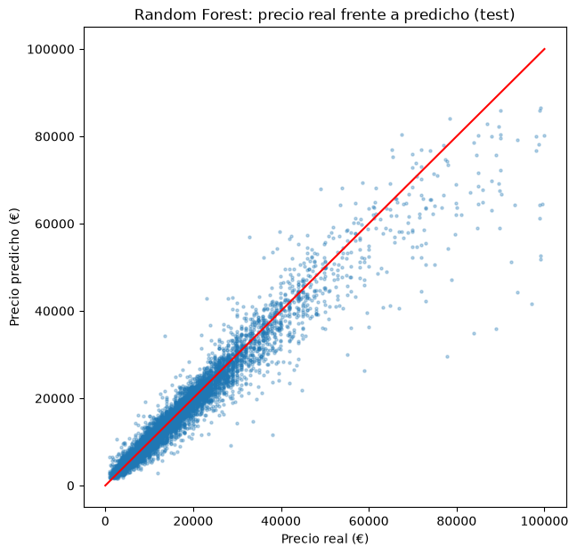

Los dos modelos sobrevaloran más o menos la mitad de los coches. Podría haberlos reentrenado para que tiraran a la baja, pero no lo hice: la protección frente a ese error la da el margen de la oferta, y lo que tocaba era medir cuánto margen hace falta.

Los dos fallan en los mismos sitios. El error del Random Forest es del 29,4 % en los coches de menos de 5.000 € y baja al 9-10 % entre 10.000 y 40.000 €. Por antigüedad, va del 8,2 % en coches de hasta 3 años al 23,2 % en los de más de 12. Los coches baratos y viejos son los más difíciles de tasar porque su precio depende sobre todo del estado en que están, y eso no aparece en los datos.

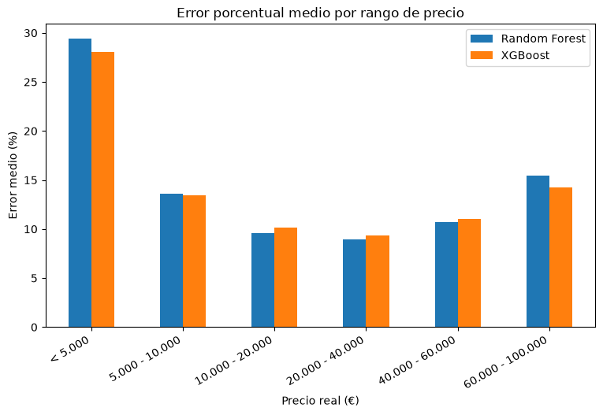

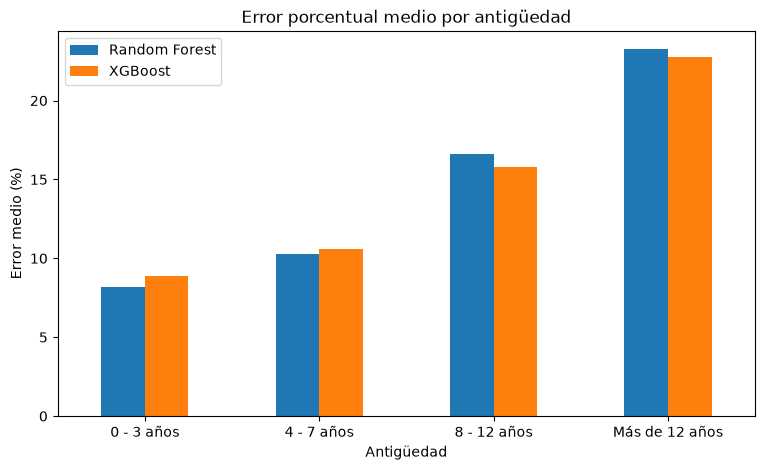

## Qué dice el modelo

Para saber qué pesa en el precio y en qué sentido usé SHAP sobre una muestra de 500 coches de prueba (cuaderno 06). Manda la antigüedad, y después el modelo del coche, la potencia y los kilómetros. El cambio automático suma alrededor de un 10 %. El vendedor, el combustible, las puertas y la marca pesan muy poco una vez que el modelo ya sabe todo lo anterior.

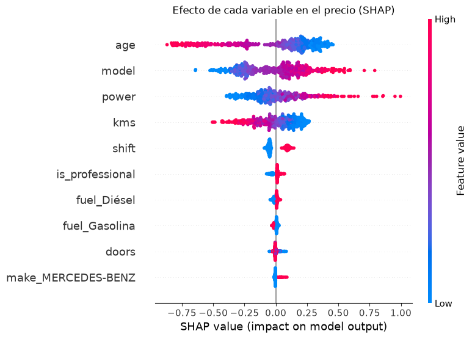

Con el modelo pude volver a las hipótesis de una forma que los datos en bruto no permiten: coger los mismos coches de prueba y cambiarles una sola cosa. Simulé cada coche con 2 años y con 8, y comparé cuánto valor conserva.

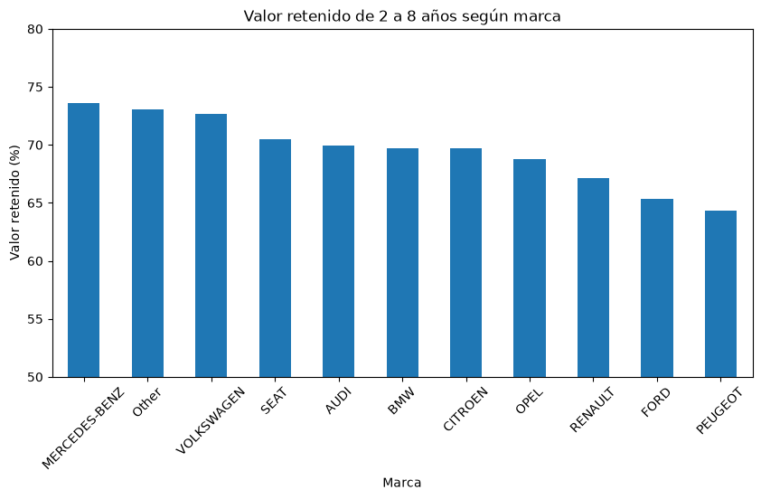

La H1 queda refutada. Audi, BMW y Mercedes-Benz conservan el 71,2 % de su valor y el resto de marcas el 70,8 %, prácticamente lo mismo. La marca que más conserva es precisamente Mercedes-Benz, con un 74 %.

La H2 queda apoyada: entre el 64 % de Peugeot y el 74 % de Mercedes-Benz hay diez puntos de diferencia en coches por lo demás idénticos. Sobre el rumor del que salió, Volkswagen aguanta bien (73 %), pero no es la que mejor lo hace, ni aquí ni en el análisis exploratorio.

La H3 queda apoyada solo en parte. Cambiando solo el combustible, el modelo da diésel (17.288 €), eléctrico (16.646 €) y gasolina (16.265 €), con diferencias pequeñas. El combustible apenas pesa porque buena parte de su efecto ya lo recoge el modelo del coche, y porque en los datos hay muy pocos eléctricos (549 de 40.614).

Quedaban las preguntas del margen. Considero que no se pierde dinero en un coche si la oferta queda por debajo de su precio real. Los costes de preparación los dejé fuera porque no tengo datos.

| Margen | Coches sin pérdida |
|---|---|
| 5 % | 67,4 % |
| 10 % | 80,1 % |
| 15 % | 88,3 % |
| 20 % | 93,0 % |
| 25 % | 95,6 % |

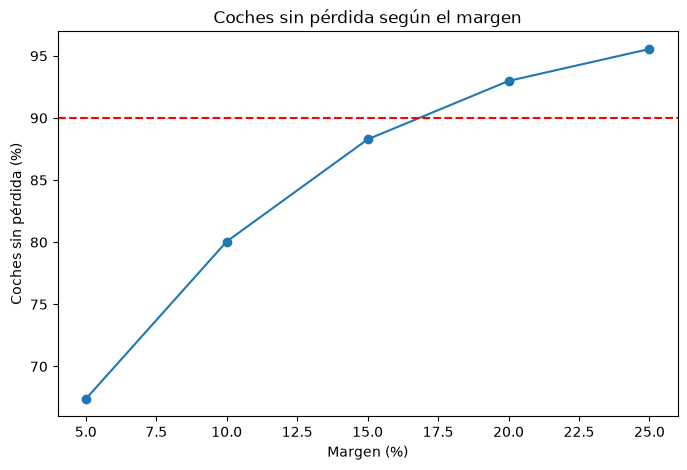

Con el 15 % de margen no se pierde dinero en el 88,3 % de los coches. Para llegar al 90 % hace falta un 16,5 %, y con ese margen la oferta mediana es el 83,4 % del precio real del coche. El 10 % restante es el que conviene que revise una persona antes de hacer la oferta.

## La app

Los resultados estaban solo en los cuadernos, y un comercial no va a abrir un cuaderno para tasar un coche. Como ampliación del trabajo inicial hice un pequeño panel interactivo con Streamlit: [tasador-coches-ocasion.streamlit.app](https://tasador-coches-ocasion.streamlit.app/).

Se rellenan los datos del coche, se ajustan el margen y los costes de preparación, y devuelve el precio estimado, un rango aproximado y la oferta de compra. Debajo enseña un gráfico con SHAP que explica por qué sale ese precio: parte del precio de un coche medio y muestra cuánto sube o baja cada característica. Así quien hace la oferta puede defenderla delante del cliente. También avisa cuando el coche se sale de lo que el modelo conoce, y recomienda revisión manual si tiene más de 12 años o el precio estimado baja de 5.000 €.

La antigüedad se pide en años y no con el año de matriculación, porque el modelo aprendió con precios de enero de 2021. El rango es el precio estimado más y menos el MAE (1.816 €); es orientativo, no un intervalo de confianza.

La app no vuelve a entrenar nada: carga el Random Forest ya entrenado. El archivo original pesa 284 MB y GitHub no admite más de 100 MB, así que usa una copia comprimida de 65 MB que da las mismas predicciones en los 8.123 coches de prueba. Está desplegada en Streamlit Community Cloud desde la rama main. La guía de uso está en [app/README.md](app/README.md).

Para un uso real haría falta algo más: pasar el código de los cuadernos a scripts, servir el modelo con una API dentro de un contenedor Docker y reentrenarlo cada cierto tiempo con anuncios nuevos.

## Lo que no hace bien

Los precios son de anuncio y de enero de 2021. El mercado de segunda mano ha cambiado mucho desde entonces, así que la herramienta sirve como ejemplo de método, no para tasar hoy.

No sabe nada del estado del coche: revisiones, golpes, ITV, equipamiento. Por eso falla tanto en los coches baratos y viejos, y por eso esos tienen que pasar por una persona.

Un error medio de 1.816 € es mucho en un coche de 4.000 € y poco en uno de 30.000 €. Un margen único para todos los coches no es lo ideal.

El Random Forest sobreajusta, como ya he contado.

Hay pocos eléctricos e híbridos, y el modelo apenas aprende de ellos.

La potencia de 3.725 coches no es un dato real, sino la más frecuente de su marca y modelo. Y hay 19 anuncios con exactamente 99.999 km, que pueden ser un relleno y que dejé como estaban porque no se puede reconstruir el dato.

Los costes de preparación no entran en la oferta.

## Cómo ejecutarlo

Está hecho con Python 3.14.

```
git clone https://github.com/rusamen86/tfm-p1-precio-coches.git
cd tfm-p1-precio-coches
python -m venv .venv
source .venv/bin/activate
pip install -r requirements.txt
```

Los cuadernos de notebooks/ se ejecutan en orden, cada uno de principio a fin. Cada uno hace solo su fase: lee lo que deja el anterior y guarda lo que necesita el siguiente.

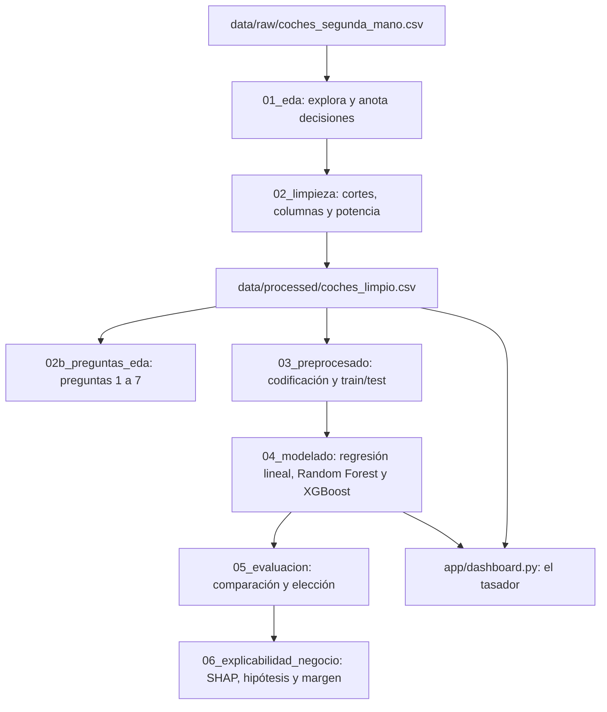

El cuaderno 04 guarda los modelos entrenados en models/ con joblib, y el 05 y el 06 los cargan de ahí sin volver a entrenar. En el 06, el cálculo de SHAP tarda un par de minutos.

La app se arranca así y se abre en el navegador:

```
streamlit run app/dashboard.py
```

Esto es lo que hay en el repositorio:

```
tfm-p1-precio-coches/
├── app/              # el tasador en Streamlit y su guía
├── data/
│   ├── raw/          # el CSV original, sin tocar
│   └── processed/    # datos limpios (solo se sube coches_limpio.csv)
├── docs/             # presentación de negocio en PDF
├── models/           # modelos entrenados (solo se sube la copia comprimida para la app)
├── notebooks/        # un cuaderno por fase
├── outputs/          # tablas de métricas y figuras
├── DECISIONES.md     # diario de decisiones, con fecha, motivo y cifra
├── requirements.txt
└── README.md
```

Trabajo en la rama develop y paso a main solo lo terminado y revisado.

## Cómo he usado la IA

He usado la IA sobre todo para la parte técnica. Lo que más ha hecho ha sido escribir código. También me ha ayudado a valorar opciones cuando había que decidir algo, como con la potencia. Pero las decisiones las he tomado yo, y hasta que no tenía las cosas claras y bien explicadas no daba nada por bueno. Esas explicaciones están en los propios cuadernos, y cada decisión, con su fecha y su motivo, en [DECISIONES.md](DECISIONES.md).

La app es la parte donde más se nota. La desarrollé junto con Claude Fable 5.2, con bastante buenos resultados, para llevar el proyecto más allá de lo que pedía el enunciado. Streamlit y joblib no se vieron en el máster; los aprendí para este trabajo.

## Para qué sirve y qué cambiaría

A un negocio de compraventa le serviría como orientación para los comerciales a la hora de hacer una oferta, teniendo siempre presentes los límites de la herramienta, y con datos bien actualizados y una base más grande. Seguramente ya tengan herramientas parecidas. A mí lo que me ha gustado es el proceso de desarrollarla, entre comillas, desde cero.

Si empezara de nuevo haría casi lo mismo. Lo único que cambiaría es intentar conseguir un conjunto de datos más completo y más grande, aunque creo que en este terreno es difícil.
